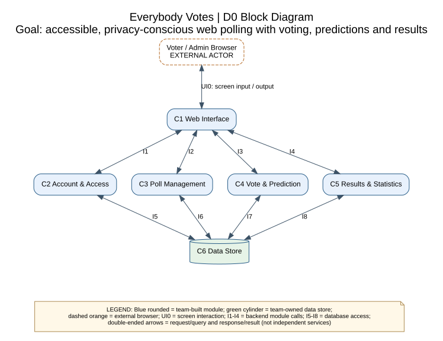
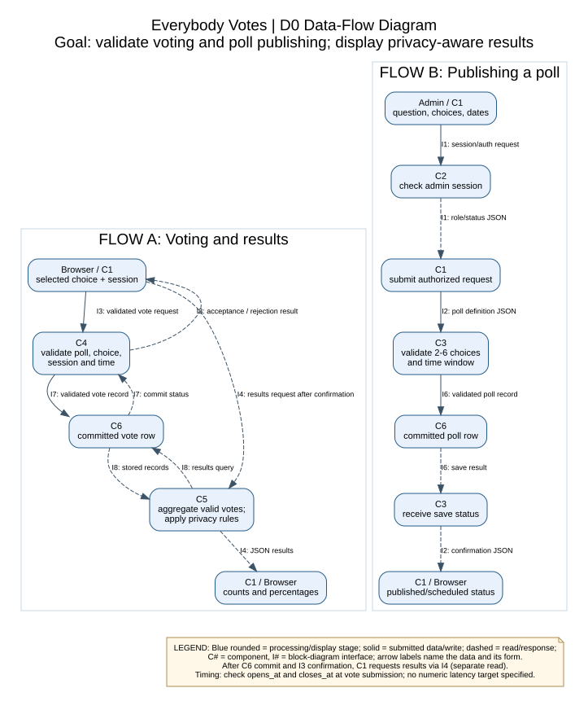

# Everybody Votes — D0 High-Level System Design
**CS 5001 — Assignment 5**  
**Team members:** Hannah Krzywkowski and Aryan Balyan

## 1. Title, goal statement, and conventions

Goal: Build a free, accessible, privacy-conscious polling website where guests and registered users vote on scheduled official polls, registered users make predictions, and voters view permitted results.
Basic inputs: poll selections, session or account credentials, optional predictions and broad demographics, and administrator-defined questions, choices and opening/closing times. Basic outputs: vote and publication confirmations, aggregate counts and percentages, prediction outcomes, and registered-user history.
Both diagrams include their own legends. C1–C5 are logical application modules, not separate deployed services; C6 is the shared data store. The browser is an external actor/platform, not a paid external dependency. UI0 is the browser-to-interface screen interaction; I1–I8 are application interfaces.

## 2. Block diagram (the D0 diagram)




## 3. Component responsibility table


| Component | Single primary responsibility | Interfaces (in / out) | Primary owner |
|---|---|---|---|
| C1 Web Interface | Present accessible voting, account, administration and results screens. | UI0, I1–I4 (both) | Hannah |
| C2 Account & Access | Verify identity, session and permissions. | I1, I5 (both) | Aryan |
| C3 Poll Management | Maintain official poll definitions and schedules. | I2, I6 (both) | Aryan |
| C4 Vote & Prediction | Validate and record eligible poll participation. | I3, I7 (both) | Hannah |
| C5 Results & Statistics | Provide permitted aggregate and personal statistics. | I4, I8 (both) | Hannah |
| C6 Data Store | Persist and retrieve application records consistently. | I5–I8 (both) | Aryan |

## 4. Interface specification table


| Interface | Input → output (summary) | Format | Failure handler |
|---|---|---|---|
| UI0 Browser ↔ C1 | User actions → accessible screens | Browser UI | C1 shows validation/connection errors. |
| I1 C1 ↔ C2 | Credentials/session → account, role, status | Internal module call | C2 rejects invalid or unauthorized access; C1 reports safely. |
| I2 C1 ↔ C3 | List/publish request → poll information/status | Internal module call | C3 validates fields, dates and admin role. |
| I3 C1 ↔ C4 | Vote/prediction → acceptance and record ID | Internal module call | C4 rejects invalid, closed or duplicate submissions. |
| I4 C1 ↔ C5 | Poll/viewer/demographic filter → permitted results | Internal module call | C5 restricts access and suppresses small groups. |
| I5 C2 ↔ C6 | Account record/query → stored account or lookup | DB query/transaction | C6 signals failures; C2 avoids leaking secrets. |
| I6 C3 ↔ C6 | Poll definition → saved poll/commit status | DB query/transaction | C6 rolls back failed publication writes. |
| I7 C4 ↔ C6 | Vote/prediction record → ID/commit status | DB transaction | C6 enforces account/session uniqueness for votes. |
| I8 C5 ↔ C6 | Poll/account/filter → stored votes/predictions | DB read/query | C5 reports read failures as unavailable. |

**Detailed interface specifications (types, errors and handling):**

- **UI0 — Browser ↔ C1:** Input `user actions:screen events`; output `rendered screen:visual/text`. Browser UI/user interaction. C1 displays validation and connection errors accessibly and keeps the interface usable.
- **I1 — C1 ↔ C2:** Input `email:string, password:string` OR `session_token:string`; output `account_id:string, role:enum, status:enum`. Internal typed-record module call; originating browser request uses HTTPS/JSON. C2 rejects invalid credentials (401) or unauthorized role (403); C1 shows a generic message.
- **I2 — C1 ↔ C3:** Input `action:enum(list,publish)`; publish requires `question:string, choices:string[2..6], opens_at:datetime, closes_at:datetime, featured:boolean`; list requires no poll-definition fields. Output `poll_id:string|null, status:enum, polls:array|null`. Internal typed-record module call; browser uses HTTPS/JSON. C3 rejects bad fields/times (400) or unauthorized publication (403); C1 identifies invalid fields. C3 verifies admin authorization server-side.
- **I3 — C1 ↔ C4:** Input `action:enum(vote,predict), poll_id:string`; vote uses `choice_id:string` and account session OR `guest_session_id:string`; prediction uses `prediction_choice_id:string` and a registered-user session. Output `vote_id:string|null` (vote), `prediction_id:string|null` (predict), `accepted:boolean, reason:string`. Internal typed-record module call; browser uses HTTPS/JSON. C4 rejects closed/invalid polls (400/403) and duplicates (409); C1 never shows false success.
- **I4 — C1 ↔ C5:** Input `poll_id:string`, viewer session/vote proof, `demographic_dimension:enum|null`; output `options:array<{choice_id:string,count:int,percent:number}>, total:int, suppressed:boolean, history:array|null`. Internal typed-record module call; browser uses HTTPS/JSON. C5 withholds results before voting and hides demographic groups with fewer than five responses; C1 explains unavailable results.
- **I5 — C2 ↔ C6:** Input `account_id:string, email:string, username:string, password_hash:string, role:enum, demographics:nullable enums`; output `stored_record:record` OR `lookup_result:record|null`. Internal database query/transaction (not HTTP). C6 signals unique-key, write or read failures; C2 returns a safe error and never exposes password hashes.
- **I6 — C3 ↔ C6:** Input `poll_id:string, question:string, choices:array, opens_at:datetime, closes_at:datetime, featured:boolean`; output `committed:boolean, poll_record:record|null`. Internal database query/transaction (not HTTP). C6 rolls back failed writes; C3 reports no publication rather than success.
- **I7 — C4 ↔ C6:** Input `poll_id:string, choice_id:string, account_id:string|null, guest_session_id:string|null, prediction_choice_id:string|null`; output `committed:boolean, vote_id:string|null` (vote), `prediction_id:string|null` (predict). Internal database transaction (not HTTP). C6 enforces one vote per registered account or guest session per poll and rolls back failed writes; C4 reports duplicates/storage failures. Guest session checks limit duplicate votes only while the same session remains identifiable; they do not guarantee one vote per person across sessions.
- **I8 — C5 ↔ C6:** Input `poll_id:string, account_id:string|null, demographic_dimension:enum|null`; output `votes:record[], poll:record|null, predictions:record[]`. Internal database read/query (not HTTP). C6 signals read failures; C5 reports unavailable, not a misleading zero count.

**Example browser-to-server JSON vote request routed to I3:**
```json
{"poll_id":"poll-12","choice_id":"choice-2","guest_session_id":"guest-abc"}
```
**Response:** `{"vote_id":"vote-77","accepted":true,"reason":"recorded"}`. All datetimes use ISO 8601 with timezone.

**Prediction handling:** After casting a vote, registered users may submit one prediction through an authenticated `predict` action on I3 before the poll closes. A successful prediction returns `prediction_id` rather than creating another vote. C4 verifies the account session, confirms the user voted, and saves the prediction through I7. C5 evaluates prediction accuracy after the poll closes using I8.

**Type conventions:** `status` is an enum such as `scheduled`, `open`, or `closed` for polls, or `active`/`disabled` for accounts (depending on the interface). `polls:array` contains poll summaries (`poll_id:string`, `question:string`, `opens_at:datetime`, `closes_at:datetime`, `status:enum`). `poll_record:record` contains those fields plus `choices:array<{choice_id:string,text:string}>` and `featured:boolean`. `votes:record[]` contains vote records (`poll_id:string`, `choice_id:string`, `account_id:string|null`, `guest_session_id:string|null`); `predictions:record[]` contains prediction records (`poll_id:string`, `account_id:string`, `prediction_choice_id:string`). `lookup_result:record` contains account metadata, not a password hash sent to the browser. These are high-level record shapes, not implementation schemas.

**Communication and interface boundaries:** UI0 represents browser interaction with C1; browser-to-server requests use HTTPS/JSON. I1–I4 represent internal calls from C1’s server-side routing to backend modules C2–C5, which are part of one application rather than separately deployed services. I5–I8 represent internal database queries or transactions, not HTTP calls. Protected operations use shared server-side authentication and authorization checks from C2; these checks are omitted as separate diagram connections to keep D0 focused on major component boundaries. Authorization does not rely solely on C1.

## 5. Data-flow diagram




Flow A: C1 → C4 → C6 (commit vote); C6 → C4 → C1 confirms the stored vote. Only after a successful confirmation, C1 initiates a separate I4 results request to C5; C5 → C6 requests aggregate data, C6 → C5 returns stored records, and C5 → C1 returns permitted results. Flow B: C1 → C2 → C1 → C3 → C6 → C3 → C1. Registered-user predictions reuse C1 → C4 → C6 after successful authentication and a recorded vote, and are evaluated by C5 after closing; this is a variation of Flow A rather than a third independent flow. Votes are accepted only within the configured opening/closing window; no numeric response-time budget is specified.

## 6. Architecture pattern and justification


**Selected patterns:** Client-server for browser-to-backend interaction; layered architecture for presentation (C1), application services (C2–C5), and persistence (C6). C2–C5 are modules in one backend, not separate servers. Shared server-side authentication and authorization checks are performed for protected operations before accessing or modifying data.

**Five criteria:** (1) **Problem fit:** polls need validation, storage and readable results; (2) **Team skills:** a two-person team can split UI, application modules and data work; (3) **Performance/timing:** database transactions prevent duplicate account/session votes, and opening/closing times are checked on submission, without a promised latency threshold; (4) **Scalability:** a small monolith can support a capstone demonstration on free-tier resources, though actual limits must be tested; (5) **Hardware:** only a standard web browser and hosting/database resources are required, with no special sensors or devices.

**Constraints and rejected alternative:** The $0 budget rules out required paid services. Authentication and role checks protect accounts; optional broad demographics and a five-response threshold protect privacy; keyboard support, labels, and text results support accessibility. **Microservices** were rejected because multiple deployments and interservice operations add unnecessary complexity and potential hosting cost.

## 7. Decision log


- **DL-01 Responsive web app.** Alternative considered: Native mobile application. Reason: One browser-based UI serves desktop/mobile with less development effort.

- **DL-02 Layered monolith.** Alternative considered: Independently deployed microservices. Reason: Logical modules in one backend simplify integration and free-tier deployment.

- **DL-03 Application-managed accounts.** Alternative considered: Third-party identity provider. Reason: No required external identity dependency; passwords must be securely hashed.

- **DL-04 Guest session voting.** Alternative considered: Require registration for every vote. Reason: Supports anonymous participation; session checks limit duplicates but cannot guarantee one vote per person.

- **DL-05 Admin-managed publication.** Alternative considered: User-published polls. Reason: Keeps official publication under administrator control without requiring public-content moderation. Registered-user suggestions remain a planned, admin-reviewed feature, not direct publication.

- **DL-06 Minimum demographic group size of five.** Alternative considered: Show every subgroup regardless of size. Reason: Protects small groups while preserving useful comparisons.

- **DL-07 Separate vote and results modules.** Alternative considered: Combine vote acceptance and aggregation. Reason: Keeps write validation independent from read/aggregation and privacy rules.

**Scope note:** Archived polls can be listed through C3 and their final statistics read through C5; registered-user poll suggestions remain planned for a later design stage. They will be submitted through C1, authenticated through C2, and handled by C3 for administrative review, with records persisted in C6. The submission/review interfaces will be specified in D1/D2; they are not claimed as already defined by I1–I8.

## Appendix A — Requirement traceability (supporting check)
US-01 guest voting → C1, C4, C6; US-02 troubleshooting → C1, C4, C6; US-03 poll publishing → C1, C2, C3, C6; US-04 accessible voting → C1, C4, C5; US-05 demographic privacy → C1, C2, C5, C6.
