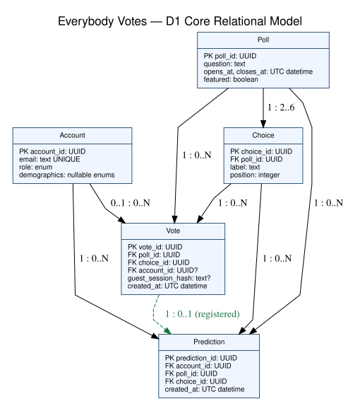

# Everybody Votes — D1 Detailed Design
**CS 5001 — Assignment 6**  
**Team members:** Hannah Krzywkowski and Aryan Balyan

## 1. Header, scope, and conventions
**Goal:** Build a free, accessible, privacy-conscious polling website where guests and registered users vote on scheduled official polls, registered users make predictions, and voters view permitted results.

D1 details C4 Vote & Prediction, C5 Results & Statistics, and C6 Data Store from D0; C1 Web Interface, C2 Account & Access, and C3 Poll Management internals are deferred to D2, while their existing D0 interfaces remain in effect.

**Figure conventions:** Rectangular record boxes represent relational entities and list behaviorally important fields. Connecting arrows represent foreign-key relationships, not data-flow direction; labels show cardinality at both ends (e.g., one Poll has 2–6 Choices, and each Choice belongs to exactly one Poll). `PK` denotes a primary key, `FK` a foreign key, `?` nullable, and `0..N` zero or more. UUID is a string identifier at the JSON boundary. The Vote–Prediction relationship applies only to registered votes; guest votes cannot have predictions. The figure describes logical relationships; constraints below provide implementation details.

## 2. Data model, the D1 diagram


**Model choice:** A relational database supports transactional vote uniqueness, poll-choice referential integrity, and grouped result queries better than a flat file or key-value store. Each vote references exactly one poll and choice; the selected choice must belong to the same poll. An account is optional on a Vote because guests participate using an opaque session key. Exactly one of account_id and guest_session_hash must be non-null. Predictions require registered accounts and a prior vote. A Prediction references a registered Vote using `(poll_id, account_id)`; a regular UNIQUE constraint on Vote `(poll_id, account_id)` supports this composite foreign key, including in SQLite. Guest votes have a NULL account_id and cannot be prediction parents.

| Structural decision | Justification / requirement |
|---|---|
| Choice is an entity, not six columns | Each poll supports 2–6 choices; a child table permits variable choice counts and stable choice IDs (US-03, AC-02.1/3). |
| Vote is an entity, not a Poll counter | Stores individual accepted responses, enforces duplicate rules, and enables statistics; a Poll has 0..N Votes (US-01, AC-01.1/4). |
| Prediction is separate from Vote | Only registered users predict after voting; a composite foreign key `(poll_id, account_id)` references the registered Vote’s ordinary unique constraint and a unique constraint permits at most one prediction per account/poll. |
| Account → Vote is optional per Vote | Guest votes have no account; registered votes have exactly one account (US-01). |
| UNIQUE (poll_id, account_id) (ordinary constraint, not partial index) | Prevents second registered-account vote while permitting multiple guest rows with NULL account_id; also supports the Prediction foreign key (AC-01.4). |
| UNIQUE (poll_id, guest_session_hash) (ordinary constraint) | Prevents second guest-session vote; does not guarantee one vote per human (AC-01.4). |
| Unique (poll_id, account_id) on Prediction | One prediction per registered account per poll. |
| Index Vote(poll_id, choice_id); Poll(opens_at, closes_at) | Speeds per-poll result grouping and active-poll filtering. |
| Index Vote(account_id, poll_id), Prediction(account_id, poll_id) | Speeds account history and accuracy calculations. |

**Additional integrity rules:** Poll closing time must exceed opening time; poll publication must atomically create 2–6 distinct choices. A composite foreign key `(poll_id, choice_id)` from Vote and Prediction to a unique `(poll_id, choice_id)` on Choice prevents cross-poll choices. SQLite foreign-key enforcement must be enabled for every database connection (`PRAGMA foreign_keys = ON`). The Vote table has a CHECK constraint requiring exactly one of account_id or guest_session_hash. A prediction must have a non-NULL account_id and its referenced vote must already exist. Account demographics are nullable broad categories; no precise location, birth date, or real name is stored. Password hashes and authentication internals belong to C2/D2. For guest voting, C2 generates a cryptographically random opaque guest identifier and stores it in Flask’s existing signed session cookie (configured Secure, HttpOnly, and SameSite in production). No separate guest cookie or server-side session store is required. Flask session cookies are signed but not encrypted, so the identifier must contain no personal information or secrets that require confidentiality. Store only a cryptographic hash of the identifier in Vote (`guest_session_hash`); the server hashes the identifier from the validated session for lookup. Establish the guest identifier before accepting a first vote. Guest duplicate prevention applies only while the same browser retains its session identifier; clearing cookies or switching browsers can allow another guest vote, so one vote per human is not guaranteed. When the visitor logs in, explicitly preserve the existing guest identifier in the Flask session (including if login code clears or replaces session data); before recording a vote for a logged-in account, check both the account ID and any existing guest-session hash for a vote on that poll. If either already voted, reject the second vote rather than treating login as a new voting identity. This does not link votes across different browsers. Keep the Flask `SECRET_KEY` private and unpredictable: anyone who obtains it could forge signed session cookies. Session issuance, expiration, cookie settings, and protection against session tampering belong to C2/D2. Normalize all timestamps to UTC before storing ISO 8601 strings in SQLite; do not compare mixed timezone formats lexicographically. Use ISO 8601 with timezone on the wire.

## 3. Core algorithms
### A. Validate and atomically record a vote (C4; I3/I7)
**Purpose:** Reject closed, invalid, or duplicate submissions and confirm only committed votes (US-01, US-02; AC-01.1, AC-01.3/4/6). **Inputs:** `poll_id: UUID`, `choice_id: UUID`, and exactly one of `account_id: UUID` (from authenticated server session) or `guest_session_hash: string` (derived server-side from a validated guest-session token); `now: datetime` (UTC server clock). **Output:** `{vote_id: UUID, accepted: true}` or a typed error.

**Procedure:** In a database transaction (`BEGIN IMMEDIATE` for SQLite writes), read the poll and choice, verify `opens_at <= now < closes_at`, and verify choice belongs to poll. For a logged-in voter, also check whether the retained guest-session hash already voted in this poll; if so, reject the submission. Insert a Vote with the authenticated account or guest-session hash; rely on database uniqueness constraints to resolve concurrent duplicate requests (SQLite may return a busy/locked error under write contention, which requires a bounded retry or 503). Commit before acknowledging success. If the unique constraint fails, return `409 DUPLICATE_VOTE`; if validation fails, insert nothing. Return `503 STORAGE_UNAVAILABLE` when the transaction outcome cannot be confirmed, never a false success. A timeout can occur after the database commits; therefore the response must not assert that no vote was recorded. On retry, uniqueness prevents a second record; the caller may check vote status using the same session identity before deciding whether to retry.

**Complexity:** Indexed lookups and insert are approximately O(log N) per vote for N stored votes, plus constant checks; at illustrative sizes of 10,000 and 1,000,000 votes, log2 N grows from ≈14 to ≈20 (about 1.4× the logarithmic term, despite 100× as many votes). O(log N) describes indexed database operations, not guaranteed end-to-end request latency; transaction locking, disk I/O, concurrency, and database latency still require testing. These are estimates, not benchmarks. **Alternative rejected:** A read-then-write duplicate check without a database unique constraint has a race condition. **Edge cases:** empty IDs/missing identity (400), nonexistent poll or choice (404), choice from another poll (422), scheduled/closed poll (409), simultaneous duplicates (409), failed storage (503). Duplicate choice labels are rejected at poll publication; ties do not affect vote acceptance.

### B. Calculate permitted poll results (C5; I4/I8)
**Purpose:** Return correct counts/percentages only after a verified vote, or after poll closure, and suppress small demographic groups (US-01, US-05; AC-01.2, AC-03 privacy criteria). **Inputs:** `poll_id: UUID`, `viewer_account_id: UUID|null`, `guest_session_hash: string|null`, `dimension: enum(age_range, gender, region)|null`, `now: datetime`. **Outputs:** Unfiltered: `{poll_id: UUID, total: integer, options: array<{choice_id: UUID, count: integer, percent: number}>, suppressed: boolean}`. Demographic-filtered: `{poll_id: UUID, dimension: enum(age_range, gender, region), groups: array<{value: string, total: integer, options: array<{choice_id: UUID, count: integer, percent: number}>}>, suppressed: boolean}`. Either request may return a typed error. Counts and totals are numbers of votes; percentages are on a 0–100 scale.

**Procedure:** Check whether the poll has closed; if not, require a recorded Vote matching the authenticated account or current guest session before revealing results. Query vote counts grouped by poll choice using SQL `GROUP BY` and a `LEFT JOIN` to include zero-vote choices. For a demographic request, accept only one of three fixed dimensions (`age_range`, `gender`, or `region`); do not combine dimensions or offer custom filters. Include only registered votes with a recorded value for the requested dimension. Count the votes in each nonempty demographic group **before** returning any group results. If **any** nonempty group has fewer than five votes, hide the **entire** demographic breakdown (`suppressed: true`, `groups: []`); otherwise return all nonempty groups (`suppressed: false`). A group with exactly five votes is allowed. Never return individual small-group counts or partially visible demographic breakdowns. Demographic responses do not include an overall poll total; unfiltered results remain available under the ordinary access rule. This conservative all-or-nothing rule is straightforward to implement and test, but it does not guarantee anonymity or eliminate every inference possible from separately published overall totals. Percentages are `100 * count / total` (zero when total is zero); rounding may not sum to exactly 100. For winner/prediction accuracy after closing, treat all choices tied for the maximum vote count as winners; an empty poll has no winner. If no registered votes contain a value for the requested demographic dimension, return an empty breakdown with `groups: []` and `suppressed: false`.

**Complexity:** A conservative upper-bound for uncached aggregation is O(V + K), K = 2..6 choices; an index-only plan or cached aggregates may do less work, depending on the query planner; 10,000 votes versus 1,000,000 votes is approximately 100× the scan/group work. An index on `(poll_id, choice_id)` reduces unrelated reads; cache/materialized aggregates are deferred until measured load justifies them. Start with SQLite uniqueness constraints, foreign keys, and the listed indexes rather than introducing caching or extra infrastructure. **Alternative rejected:** Storing only mutable counters risks inconsistencies with transactional votes and prevents reliable demographic filtering. **Edge cases:** zero votes (all 0%), zero-vote options, ties, missing demographic values (excluded from demographic groups), any nonempty group with 1–4 votes (hide the entire breakdown), a group with exactly five votes (allow), invalid dimension (400), results requested before voting (403), storage failure (503). Enforce suppression on the server, not only in the browser.

## 4. Build-versus-reuse decisions
**Implementation priority:** Build and test poll publishing, voting, results, and predictions first; then implement only the three fixed, single-dimension demographic comparisons already required, after the core workflow works. Use the all-or-nothing five-response suppression rule; do not add multi-dimensional filters or complex inference checks.

**Selected minimum-cost stack:** Python + Flask with Jinja2 server-rendered HTML templates + SQLite + standard HTML/CSS and minimal JavaScript, developed and demonstrated locally with a plan to deploy the same single application to a genuinely free public host if one meets the project budget. These are design choices for team review, not claims that every dependency is already installed. Flask renders the primary pages with Jinja2 templates; ordinary HTML forms handle routine interactions without requiring JavaScript, while the documented JSON API endpoints remain available for optional dynamic features. No separately deployed frontend application is needed. This avoids React, FastAPI, a separate database server, and paid hosting. A public deployment is optional and must use a verified permanent free tier if chosen.

| Piece | Build or reuse | Library/service and license | Maturity, performance, and fit |
|---|---|---|---|
| Vote validation and uniqueness | Build | Team-authored code | Poll-specific logic; enforce atomic uniqueness with SQLite constraints and transactions. |
| Results and privacy suppression | Build | Team-authored SQL and Python | Simple all-or-nothing five-vote demographic threshold; GROUP BY supports small poll workloads. |
| Relational database | Reuse | SQLite — public domain | Mature embedded SQL engine; no server or subscription; WAL mode improves reader/writer coexistence, though writes serialize. |
| HTTP API and server | Reuse | Flask — BSD-3-Clause | Mature, lightweight Python web framework; small learning and deployment footprint. |
| SQL access | Reuse | Python `sqlite3` — Python Software Foundation License | Built-in parameterized SQL and transactions; no ORM needed for this limited schema. |
| Front end | Build using standards | HTML/CSS/JavaScript — web standards, no commercial license | Accessible native controls; start with ordinary HTML forms for routine tasks and add JavaScript only if a specific feature needs dynamic updates. |
| Server-side HTML templates | Reuse | Jinja2 — BSD-3-Clause; installed as a Flask dependency | Render reusable page layouts and poll data on the server; no separate frontend framework or build pipeline. |
| Password hashing (C2 integration) | Reuse | Werkzeug `generate_password_hash` / `check_password_hash` (scrypt; BSD-3-Clause) | Included with Flask's dependencies; secure password hashing without another package. |
| Sessions and CSRF protection (C2) | Reuse + configure | Flask signed sessions holding a random guest identifier (BSD-3-Clause) and Flask-WTF CSRFProtect (BSD-3-Clause) | Flask’s signed cookie is not encrypted or server-side storage; the random guest identifier in the existing session is hashed before storage in Vote. No extra guest cookie is needed. CSRFProtect protects cookie-authenticated POST requests; use Secure, HttpOnly, SameSite cookies in production. |
| Date/time parsing | Reuse | Python `datetime` — Python Software Foundation License | Timezone-aware UTC comparisons without hand-written parsing. |

**Library check:** Before implementation, pin maintained Flask and Flask-WTF releases and verify their licenses and security updates. Werkzeug is installed as a Flask dependency; Python's `sqlite3` and `datetime` are in the standard library. SQLite is suitable for low-to-moderate write concurrency and a small demonstration; load-test concurrent votes before promising large public traffic. SQLite supports partial indexes, but a foreign key must reference a primary key or columns covered by an appropriate non-partial UNIQUE constraint; ordinary UNIQUE constraints are used here.

## 5. API contract
The main website uses server-rendered Jinja2 HTML pages. Ordinary HTML forms submit to Flask page routes for routine actions; these routes call the same vote and prediction validation functions as the versioned JSON API endpoints below. HTML forms do not send JSON automatically. The JSON endpoints remain available for minimal JavaScript enhancements and other API clients. Both page routes and JSON routes reuse the same Python service functions and SQLite database transactions; they are not separate backends. Implement the HTML form workflow first, then expose the documented JSON routes as thin wrappers around that same logic. Browser requests use HTTPS when publicly deployed (HTTP on localhost during development); C1 routes to C4/C5 as internal module calls (I3/I4), not separately deployed microservices. For unauthenticated visitors, C2 generates a random guest identifier inside the existing Flask signed session before the first accepted vote; if missing or expired, it establishes a new identifier. During login, explicitly carry the existing guest identifier into the authenticated Flask session, even if login code clears or replaces session data, so the vote handler can check for a prior guest vote before accepting a registered vote. The database stores only its hash. Flask sends the signed session through its ordinary HTTP `Set-Cookie` header, never in JSON. This does not require a second cookie or a server-side session service. Protect Flask’s secret signing key (`SECRET_KEY`) and never commit it to the repository. Set `Secure` on HTTPS; use an appropriate localhost-only development configuration. IDs are UUID strings in canonical UUID syntax; malformed UUIDs or JSON bodies return `400 INVALID_INPUT`. Unknown JSON fields are rejected consistently with `400 INVALID_INPUT`; the server verifies that each `choice_id` belongs to the requested poll. Timestamps use ISO 8601 with timezone. Authentication/session identity comes from an HTTP-only secure session cookie and is never trusted from a client-supplied account ID.

<div style="page-break-before: always;"></div>

### Vote Endpoint

| Field | Specification |
|---|---|
| Endpoint | `POST /api/v1/polls/{poll_id}/votes` |
| Inputs | `poll_id`: required UUID path; body `choice_id`: required UUID; session cookie optional for guests, required for account attribution |
| Success output | `201 {vote_id:string, accepted:boolean, reason:string}` |
| Errors | `400 INVALID_INPUT`; `404 POLL_NOT_FOUND`; `422 INVALID_CHOICE`; `409 POLL_NOT_OPEN` or `DUPLICATE_VOTE`; `503 STORAGE_UNAVAILABLE` |

### Results Endpoint

| Field | Specification |
|---|---|
| Endpoint | `GET /api/v1/polls/{poll_id}/results` |
| Inputs | `poll_id`: required UUID; `dimension`: optional single enum `age_range`, `gender`, or `region` (no combined dimensions or other filters); session cookie for pre-close proof |
| Success output (unfiltered) | `200 {poll_id:string, total:integer, options:[{choice_id:string, count:integer, percent:number}], suppressed:false}` |
| Success output (filtered) | `200 {poll_id:string, dimension:string, groups:[{value:string, total:integer, options:[{choice_id:string, count:integer, percent:number}]}], suppressed:boolean}`; percentages 0–100 |
| Errors | `400 INVALID_INPUT` or `INVALID_DIMENSION`; `403 RESULTS_HIDDEN`; `404 POLL_NOT_FOUND`; `503 STORAGE_UNAVAILABLE` |

### Prediction Endpoint

| Field | Specification |
|---|---|
| Endpoint | `POST /api/v1/polls/{poll_id}/predictions` |
| Inputs | `poll_id`: required UUID; body `choice_id`: required UUID; registered session required |
| Success output | `201 {prediction_id:string, accepted:boolean}` |
| Errors | `400 INVALID_INPUT`; `401 AUTH_REQUIRED`; `403 VOTE_REQUIRED`; `404 POLL_NOT_FOUND`; `422 INVALID_CHOICE`; `409 POLL_NOT_OPEN` or `DUPLICATE_PREDICTION`; `503 STORAGE_UNAVAILABLE` |

All errors use `{ "error": { "code": string, "message": string } }` with no private response data. An unfiltered response contains `total` and `options` for the whole poll. A demographic-filtered response instead contains `dimension` and `groups`, with **no overall `total` or `options`**. A demographic request returns all nonempty groups only if **every** such group has at least five votes. If any nonempty group has fewer than five votes, return `groups: []` and `suppressed: true`; otherwise return all groups and `suppressed: false`. Groups with no votes are omitted. This is a conservative, easy-to-test privacy rule, not a guarantee against inference from separately available overall results. A filtered request never returns a hidden group's count. Demographic queries accept at most one dimension and no additional filters. The first anonymous request establishes a guest identifier inside the existing Flask session cookie (`Set-Cookie` response header, not JSON); callers never supply a raw session key or account ID in JSON. When an account logs in, explicitly retain the existing guest identifier in the authenticated Flask session (even if login code clears session data) and reject a new vote if either that guest identifier or the account already voted on the poll.

**Example request** (poll UUID is illustrative):
```http
POST /api/v1/polls/11111111-1111-4111-8111-111111111111/votes
Content-Type: application/json

{"choice_id":"22222222-2222-4222-8222-222222222222"}
```
**Example successful response (201):** The server may also send Flask’s session `Set-Cookie` header when establishing the guest identifier; the identifier is not part of this JSON body.
```json
{
  "vote_id": "33333333-3333-4333-8333-333333333333",
  "accepted": true,
  "reason": "recorded"
}
```
**Versioning:** The public HTTP API is versioned in the URL (`/api/v1`); removing/renaming fields, changing field types or meanings, or changing existing error semantics is breaking and requires `/api/v2`, while adding optional fields is nonbreaking.

**Prediction time rule:** Before inserting a prediction, C4 checks that the user is registered, has a recorded vote on the same poll, and that `opens_at <= now < closes_at`. A prediction after closure or before opening returns `409 POLL_NOT_OPEN`; a duplicate returns `409 DUPLICATE_PREDICTION`. The database foreign key ensures the prior vote exists, and the server enforces the time window. These checks must occur within a transaction. Cookie-authenticated POST endpoints also require a CSRF token validated server-side (Flask-WTF CSRFProtect); the browser sends it in a request header for JSON POST requests.

## 6. Technology choices with justification

**Database — SQLite.** **Team skill fit:** Hannah has SQL experience, and SQLite uses standard relational concepts without requiring either teammate to administer a separate database server. **Licensing:** SQLite is public domain and free. **Community support:** It is mature, widely documented, and included in Python via `sqlite3`. **Performance:** Indexes, transactions, foreign keys (explicitly enabled), and SQL aggregation fit a modest polling demonstration; writes are serialized, so concurrency must be tested. **Cost and hosting:** The database is a local file, with no account, service, or recurring fee. **Alternative passed over:** PostgreSQL has stronger high-concurrency and hosted multi-user capabilities but adds setup and server administration that the initial project does not need.

**Backend — Python with Flask.** **Team skill fit:** Hannah has Python experience; Flask has a small API and avoids introducing an additional language. Aryan has experience working with Python backend routes, SQL queries, and basic database operations. **Licensing:** Flask uses BSD-3-Clause, and Python is available under a permissive open-source license. **Community support:** Both have established documentation and large developer communities. **Performance:** Lightweight endpoints and indexed SQLite queries are sufficient for initial testing; actual response times will be measured. **Cost and hosting:** Flask runs locally for free without cloud services. **Alternative passed over:** FastAPI offers built-in typed validation and automatic documentation but introduces additional framework conventions and dependencies for this small project.

**Front end — Jinja2 server-rendered HTML, CSS, and minimal JavaScript.** **Team skill fit:** Hannah has documented experience with HTML, CSS, and JavaScript. Jinja2 introduces minimal additional learning because it uses familiar HTML templates. Aryan is comfortable reading and editing HTML/CSS templates and connecting forms to Flask routes. **Licensing:** These open web standards do not require a paid framework license. **Community support:** Browser documentation, accessibility standards, and examples are extensive. **Performance:** Three featured polls with two to six choices each are small enough for server-rendered templates and occasional DOM updates; no single-page application is necessary. **Cost and hosting:** Flask serves Jinja2-rendered pages and static assets locally for $0; Jinja2 is installed with Flask. **Alternative passed over:** React offers reusable components but adds dependencies, build tooling, and learning overhead without a clear MVP need.

**Messaging and hardware — ordinary browser HTTP/JSON; no queue or device.** **Team skill fit:** Standard HTML forms, optional browser `fetch` requests, and Flask routes are straightforward to debug using existing web skills. **Licensing:** Open web standards do not require commercial licensing. **Community support:** They are broadly documented and supported. **Performance:** Synchronous requests fit the small initial workload; database transactions enforce vote integrity. **Cost and hosting:** No message broker or hardware purchase is needed. **Alternative passed over:** A separate queue would complicate delivery and error handling without an identified bottleneck.

**Hosting — local development; public deployment subject to advisor confirmation.** **Team skill fit:** Both students can run the app on a development computer with Python and SQLite, avoiding cloud configuration. **Licensing:** The chosen software is free/open-source; any optional hosting provider's terms must be checked separately. **Community support:** Flask and Python have established local development and deployment guides. **Performance:** Local testing avoids cold-start delays, but public load and uptime cannot be inferred from local benchmarks. **Cost and hosting:** Development and a live demonstration on the team's computer cost $0. Since D0 calls for a polling website, the team must confirm with its faculty advisor whether publicly accessible deployment is required. Until that is confirmed, local development and demonstration are the committed $0 plan, not a claim of public availability. If public deployment is required, the team will select and verify a genuinely free host that supports a running Flask app, persistent SQLite storage, and HTTPS; otherwise the team will demonstrate locally and document the access limitation. **Alternative passed over:** Paid virtual machines and managed database services violate the project's zero-dollar constraint; a static-only host is insufficient because voting requires a running Python backend and persistent data.

**Deployment decision:** Ask the faculty advisor whether a public URL is required for the final demonstration. Do not commit to a hosting vendor or claim free public hosting until its persistent-storage and HTTPS terms are verified.

**Implementation boundary:** C1 is implemented with Flask/Jinja2-rendered pages and small JavaScript enhancements, while C2–C5 remain logical modules within the same Flask application and C6 is SQLite. The API endpoints in Section 5 are preserved; this choice does not change D0 interfaces or the data-model diagram.
