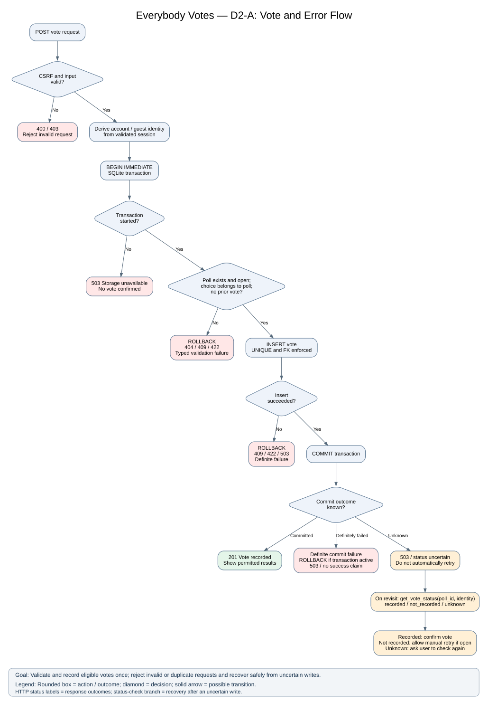
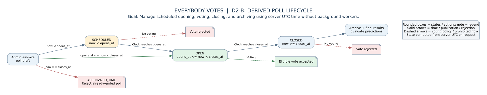

# Everybody Votes — D2 Detailed Design
**CS 5001 — Assignment 7**  
**Team members:** Hannah Krzywkowski and Aryan Balyan  
**Goal:** Build a free, accessible, privacy-conscious polling website where guests and registered users vote on scheduled official polls, registered users make predictions, and voters view permitted results.

## 1. Header, conventions, and D2 overview

**Two-minute overview.** Everybody Votes is a browser-based revival of the Wii polling experience. Up to three featured official polls are displayed. Guests can vote without registering; accounts enable voting history, optional demographics, and predictions. Administrators schedule polls; results remain hidden until a voter participates or the poll closes. The backend is one Flask application with Jinja2 pages and a SQLite database. D0 defines the six logical modules and interfaces; D1 defines the Vote, Prediction, Poll, Choice, and Account relationships, voting transactions, aggregation, and API contracts for C4–C6. This D2 finishes C1–C3, defines supporting behavior, and checks all modules for failure cases.

**Diagram files:** `D2_Vote_Error_Flow.svg` and `D2_Poll_Lifecycle.svg`

**Diagram conventions.** In Figure D2-A, rounded boxes are actions, diamonds are decisions, solid arrows are possible transitions, and labeled terminal boxes are returned HTTP outcomes. In Figure D2-B, rounded boxes are poll lifecycle states, arrows are clock- or administrator-triggered transitions, and a crossed-out arrow means the transition is forbidden. The goal above applies to both figures. D0 diagrams use rectangles for logical modules and arrows for interfaces or flows; the D1 ER diagram uses entity rectangles and cardinality-labeled foreign-key arrows. C1–C5 are logical Python modules, not separate servers; C6 is SQLite. I1–I8 keep the meaning assigned in D0.

**Known gaps and questions.** Public hosting with persistent SQLite storage and HTTPS is not yet confirmed. The team will ask the course instructor whether a public URL is required for the final demonstration. Until then, a local Flask and SQLite demonstration remains the planned $0 fallback. User poll suggestions are excluded from the minimum version in User Stories, although D0 mentions them as a possible later feature; no suggestion endpoint is committed in D2. Account deletion, password-reset email, automated recurring poll rotation, and external notifications (email or push) are out of scope. Simple on-page confirmations and error messages remain part of the user interface. **Resolved G-01:** User Stories AC-03.3 and D1 agree on the all-or-nothing demographic suppression rule. No D1 changes are required.

## 2. Finished components, the D2 diagrams

### C1 — Web Interface (owner: Hannah)
**Persistent data:** No persistent data of its own. Reads view models from C2–C5; browser keeps only Flask's signed session cookie and transient form input. Templates: `home.html`, `poll.html`, `results.html`, `login.html`, `register.html`, `profile.html`, `history.html`, `archive.html`, `admin_poll.html`, `error.html`; one shared base template and CSS file.

**Behavior:** (1) Route request to correct page; (2) obtain permitted poll/account data from a server-side module; (3) render labeled radio choices, forms and plain-text counts/percentages; (4) show field-specific errors without clearing safe input; (5) preserve visible keyboard focus and error announcements; (6) never render hidden pre-vote results. Use ordinary HTML forms; JavaScript is optional enhancement, not required for voting.

**Interface (UI0, I1–I4):** `GET /`, `/polls/<id>`, `/archive`, `/login`, `/register`, `/profile`, `/history`, `/admin/polls/new`; HTML 200 or 404/403/503. Form POSTs call the C2–C4 service functions. The D1 JSON `/api/v1` endpoints remain available; no second independent business-logic implementation. C1 maps typed errors to a readable message and appropriate HTTP status. No raw database rows, password hashes, or session identifiers appear in HTML.

### C2 — Account & Access (owner: Aryan)
**Data model:** D1 `Account` extended/confirmed with `account_id` UUID PK, unique case-normalized `email`, unique `username`, `password_hash`, `role` (`user` or `admin`), `status` (`active` or `disabled`), nullable `age_range`, `gender`, `region`, and `created_at` UTC. Do not collect real name, exact birthday, phone, or address. `role` is never accepted from registration input. No extra session table: Flask signed cookies carry an account identifier and a random guest identifier; session content is signed, not encrypted. Guest duplicate-vote prevention is limited to the same browser session; it does not guarantee one vote per person across different browsers or devices. When a guest logs in, duplicate-vote checks consider both the retained guest identifier and the registered account.

**Behavior:** Registration validates username/email/password, normalizes email, checks uniqueness, hashes password with Werkzeug's maintained password-hashing utility, and inserts an ordinary `user`. Login verifies hash and active status, retains any existing guest identifier across session renewal, and sets the authenticated account ID. Logout removes account identity but may retain the guest identifier. `require_login` and `require_admin` check permissions server-side on every protected action. Profile update accepts only the three optional demographic enums, including blank/decline. Sessions expire after a configured interval. POST requests use Flask-WTF CSRF validation, including JSON POSTs via a token header.

**Session rules:** Logout removes the authenticated account ID and role, while retaining only the existing anonymous guest identifier if present; it does not erase prior votes. On every protected request, `current_identity` verifies that the account still exists and has `active` status, so a disabled account loses access even if its signed cookie has not expired. An expired, invalid, or tampered cookie grants no account privileges; the visitor may start a fresh guest session, but this cannot restore a prior browser identity. Rotating `SECRET_KEY` invalidates previously signed sessions and requires login again. A missing guest identifier is replaced with a new random one; duplicate protection cannot connect it to the lost identifier. All these checks occur server-side.

**Interfaces (I1/I5):** `POST /register` fields `username,email,password` -> redirect or 400/409; `POST /login` `email,password` -> redirect or 401; `POST /logout` -> redirect; `GET/POST /profile` -> profile or 401/400. Internal `current_identity()->{account_id|null,role,guest_hash}`; `require_admin()->allow|403`; `register(data)->account_id|typed_error`; `login(data)->session|401`; `update_demographics(account_id,data)->ok|typed_error`. Generic login failure does not reveal whether an email exists. Login POST does not accept an account ID or role supplied by the browser.

### C3 — Poll Management (owner: Aryan)
**Data model:** D1 `Poll` (`poll_id`, `question`, `opens_at`, `closes_at`, `featured`, `created_by`) and `Choice` (`choice_id`, `poll_id`, `text`, `display_order`). A poll's `scheduled/open/closed` state is **derived from the server's UTC clock**, not maintained by a background worker. No separate lifecycle table. Maximum three *currently open featured* polls in the homepage query. An archive is the query for polls whose close time has passed.

**Behavior:** `publish_poll(data: PollDraft, identity: AuthIdentity)` checks admin role; trims text; requires nonempty question, 2–6 distinct nonempty choice texts, `closes > opens`, and `closes > now` (reject already-ended polls); inserts Poll and all Choices in one transaction; returns ID only after commit. `list_featured(now)` selects featured polls satisfying `opens <= now < closes`, sorted by opening time and ID, LIMIT 3. `list_archive(now)` returns closed polls ordered by close time descending. `get_poll(id)` returns its choices and computed status. To keep implementation small, the minimum version does not include editing published polls, deletion, or recurring scheduling. Marking more than three polls featured is permitted in storage, but the homepage shows at most three; admin UI should explain this.

**Interfaces (I2/I6):** `GET /api/v1/polls?view=featured|archive` -> `200 {polls:[...]}`; `GET /api/v1/polls/{poll_id}` -> poll/choices or 404; `POST /api/v1/admin/polls` -> `201 {poll_id,status}` or 400 INVALID_INPUT, 401 AUTH_REQUIRED, 403 FORBIDDEN, 409 DUPLICATE_CHOICE, 503 STORAGE_UNAVAILABLE. All writes are CSRF-protected. Internal `publish_poll(data,identity)` and `list_polls(view,now)` accept typed records, not a long positional parameter list.

**PollDraft fields:** `question:string`, `choices:string[2..6]`, `opens_at:datetime`, `closes_at:datetime`, and `featured:boolean`. All timestamps use UTC.

### Vote-status recovery contract (C4/C2/C6 integration)
**Purpose:** When a vote response is lost or the database commit outcome is uncertain, check whether the current browser/account already has a recorded vote before allowing a manual retry. This is an internal read-only service, not another deployed component or a required new public API endpoint.

**Interface:** `get_vote_status(poll_id, identity) -> recorded | not_recorded | unknown`. `identity` is derived by C2 from the validated Flask session, never from a client-supplied account ID or guest hash. C4 checks Vote for the authenticated account and any retained guest-session hash. Return `recorded` if either identity has a matching vote, `not_recorded` only after a successful authoritative database read finds none, and `unknown` if the database cannot be read or the original identity was lost. Do not disclose a choice or another person's vote. The existing poll page can call this service when the user revisits it: show "Your vote was recorded" for `recorded`, offer a new submission only for `not_recorded` while the poll is open, and show "We could not confirm your vote; try checking again" for `unknown`. Never automatically resubmit a vote after a timeout. A lost guest cookie cannot reliably recover the old vote; explain this limitation without claiming the vote failed. See E04, E16, and E41.

### Supporting glue (no new deployed components)
| Concern / owner | Data model | Behavior | Interface and failure |
|---|---|---|---|
| Authentication / Aryan | Account and signed Flask session (C2) | Check session on each protected route; preserve guest identifier at login | `current_identity`, `require_login`, `require_admin`; 401/403; expired session redirects to login |
| Notifications / Hannah | **No persistent data** | Only on-page confirmation, accessible errors and result status; no email/push service | `flash(message,category)` or inline HTML status; no delivery guarantees |
| Configuration / Aryan | **No persistent data** | Load `SECRET_KEY`, SQLite path, cookie flags, session lifetime, CSRF setting from environment/config at startup; fail closed if production secret missing | `load_config()->settings|startup_error`; no public config endpoint |
| Logging / Aryan | **No persistent data required** (local rotating text log optional) | Log UTC time, event code, route and request ID; never log passwords, cookies, vote choice, or demographics | `log_event(code,request_id,route)`; logging failure must not falsely confirm a vote |
| Storage / Aryan | D1 Account, Poll, Choice, Vote, Prediction | Enable SQLite foreign keys on each connection; transactions, indexes, parameterized SQL | I5–I8; constraint errors mapped to 409/422; temporary locks bounded retry then 503 |

### Figure D2-A — Vote and results decision flow (includes failures)
**Everybody Votes — goal:** free, accessible, privacy-conscious scheduled polling. **Legend:** `(action)` action; `{question?}` decision; `-->` control flow; `[HTTP status]` response. 

### Figure D2-B — Derived poll lifecycle
**Everybody Votes — goal:** free, accessible, privacy-conscious scheduled polling. **Legend:** `(state)` is computed from UTC clock; `-->` transition when time condition becomes true; `-X->` prohibited vote.

### D0 interface audit
| D0 interface | Finalized boundary / decision |
|---|---|
| UI0 | HTML pages and form events; errors rendered in text and announced accessibly |
| I1 | C1 calls C2 with credentials or session context; account ID derived server-side |
| I2 | C1 passes a `PollDraft` record to C3, not separate long positional parameters |
| I3 | D1's `POST /api/v1/polls/{id}/votes` and `/predictions` unchanged |
| I4 | D1's `/results` endpoint; viewer identity is obtained server-side |
| I5 | C2 uses parameterized Account SQL and transactions; no hash exposed to C1 |
| I6 | C3 atomically writes Poll and Choices; rollback on any invalid child |
| I7 | C4 uses D1 transaction and uniqueness rules; no raw guest ID sent to browser JSON |
| I8 | C5 reads aggregated data; no individual vote records exposed to browser |

## 3. Edge cases and error handling
**Category codes:** B = boundary values; T = timing/concurrency; I = bad/missing input; E = external dependencies. **Recoverable** means the user or system can retry or correct input without changing architecture. A database failure is not treated as evidence of a successful write.

| ID | Component | Category | Edge case | Decided behavior, named handler, recoverable? |
|---|---|---|---|---|
| E01 | C1 UI | B | No featured polls | `render_home`: degrade to empty-state text; yes |
| E02 | C1 UI | T | Double-click vote button | `render_vote_response`: rely on C4 uniqueness, show 409; yes |
| E03 | C1 UI | I | Form field missing | `validate_form`: 400 with field message; yes |
| E04 | C1 UI | E | Network drops while submitting | `render_network_error`: surface uncertain status; check before retry; yes |
| E05 | C2 Accounts | B | All demographics blank | `update_demographics`: accept NULLs; yes |
| E06 | C2 Accounts | T | Simultaneous registrations with same email | `register`: UNIQUE constraint, one 409; yes |
| E07 | C2 Accounts | I | Incorrect password or missing CSRF | `login`/`csrf_guard`: 401/403; yes |
| E08 | C2 Accounts | E | Session secret missing in production | `load_config`: fail startup; no until configured |
| E09 | C3 Polls | B | One or seven choices | `validate_poll_draft`: 400; yes |
| E10 | C3 Polls | T | Poll closes during vote | `record_vote`: check server UTC inside transaction; 409; yes (other poll) |
| E11 | C3 Polls | I | End before start, already-ended poll, or repeated choices | `validate_poll_draft`: 400; yes |
| E12 | C3 Polls | E | SQLite unavailable during publish | `publish_poll`: rollback and 503; yes after recovery |
| E13 | C4 Vote/Prediction | B | Poll with zero votes | `record_vote`: accept first eligible vote; yes |
| E14 | C4 Vote/Prediction | T | Two requests same identity | `record_vote`: unique constraint, one success, one 409; yes |
| E15 | C4 Vote/Prediction | I | Choice from another poll | `record_vote`: 422; yes |
| E16 | C4 Vote/Prediction | E | SQLite busy / ambiguous commit | `record_vote`: bounded retry for confirmed lock failures; return 503 if unavailable. If commit status is unknown, check vote status before resubmission; recoverable when identity and database access remain available. |
| E17 | C5 Results | B | Zero votes on closed poll | `calculate_results`: zero counts and 0.0%; yes |
| E18 | C5 Results | T | Result read races with closing time | `authorize_results`: compare server UTC and vote proof on each read; yes |
| E19 | C5 Results | I | Unsupported demographic filter | `validate_dimension`: 400; yes |
| E20 | C5 Results | E | Aggregation query fails | `calculate_results`: 503, never invented zeros; yes |
| E21 | C6 Storage | B | NULL account for guest vote | `save_vote`: accept only if guest hash present; yes |
| E22 | C6 Storage | T | Concurrent SQLite writes | `db_transaction`: short busy timeout/bounded retry, then 503; yes |
| E23 | C6 Storage | I | Invalid FK or both identities set | `db_transaction`: rollback 422/409; yes |
| E24 | C6 Storage | E | Disk full / DB inaccessible | `db_transaction`: rollback/503 and log; yes after repair |
| E25 | Config | B | Session lifetime set to zero | `load_config`: reject startup configuration; yes |
| E26 | Config | T | Secret rotated during session | `current_identity`: old session invalid, re-login; yes |
| E27 | Config | I | Malformed database path | `load_config`: fail startup; yes |
| E28 | Config | E | Host lacks writable storage | `load_config`: fail startup, local demo fallback; yes |
| E29 | Logging | B | Empty optional request ID | `log_event`: generate ID; yes |
| E30 | Logging | T | Multiple simultaneous log writes | `log_event`: standard thread-safe logger; yes |
| E31 | Logging | I | Sensitive field accidentally supplied | `log_event`: allowlist safe fields only; yes |
| E32 | Logging | E | Log file unwritable | `log_event`: stderr fallback, no vote-data leakage; yes |
| E33 | Notifications | B | Empty confirmation text | `show_status`: use default safe message; yes |
| E34 | Notifications | T | Page refresh after confirmation | `show_status`: one-time flash, vote stays committed; yes |
| E35 | Notifications | I | Unknown message category | `show_status`: use generic error category; yes |
| E36 | Notifications | E | Browser blocks JavaScript | `show_status`: server-rendered HTML remains usable; yes |
| E37 | Authentication | B | Guest with no session cookie | `ensure_guest_id`: issue random identifier before voting; yes |
| E38 | Authentication | T | Guest votes then logs in | `login` + `record_vote`: preserve guest ID, reject second vote; yes |
| E39 | Authentication | I | Forged/expired cookie | `current_identity`: reject/renew session; yes |
| E40 | Authentication | E | CSRF token absent after expired page | `csrf_guard`: 403 and refresh form; yes |
| E41 | C4 Vote recovery | T | Response lost after vote may have committed | `get_vote_status`: return recorded/not_recorded/unknown; never blind-retry; yes if identity and storage remain available |
| E42 | C5 Results | B | Demographic group has four vs five votes | `calculate_results`: suppress entire breakdown if any nonempty group has 1–4; show only when all groups have at least five; yes |
| E43 | C4 Prediction | I | Registered user predicts before voting | `create_prediction`: 403 VOTE_REQUIRED; yes after valid vote |
| E44 | C4 Prediction | T | Duplicate prediction or poll already closed | `create_prediction`: 409 DUPLICATE_PREDICTION or POLL_NOT_OPEN; yes only for a different open poll |
| E45 | C5 Results/Prediction | B | Tie for winning choice or poll with no votes | `calculate_winners`: all tied maximum-count choices win; no winner for empty poll; yes |
| E46 | C5 History | I | User requests another account's history | `get_account_history`: use account ID from authenticated session; reject unauthorized access with 403; yes after correct login |
| E47 | C2 Authentication | T | Account disabled while session remains valid | `current_identity`: recheck active status and reject protected actions; yes after reactivation |
| E48 | C2 Authentication | B | Logout or guest identifier lost | `logout` / `ensure_guest_id`: remove account access on logout; retain existing guest ID if available, otherwise create a new one. Recoverable for future sessions, but prior votes cannot be linked across lost guest identifiers. |

**Known versus uncertain write failures:** A definite insert or constraint failure is rolled back and mapped to its typed 409/422/503 response; only an unknown commit outcome triggers vote-status recovery. The D2-A flow distinguishes these branches.

**Privacy edge boundary (G-01 resolved):** For each requested demographic category, if any nonempty group contains 1–4 valid responses, hide that category’s entire breakdown; if every nonempty group has at least five, the breakdown may be displayed. Overall poll totals remain available. Test the four-versus-five boundary, multiple groups, and optional/unknown demographics. This follows D1 and updated AC-03.3.

## 4. Requirements traceability table
**Priority:** M = must have for the minimum product. All requirements listed in this table are included in the planned MVP; optional and deferred features are identified separately in the scope exclusions. Each row names a concrete implementation element and a related edge case. Scope derives from the supplied User Stories, D0, D1 and constraints; supplementary minimum-product items have `MVP` IDs rather than invented original acceptance IDs.

| ID and requirement | Priority | Specific design element / figure | How satisfied; edge cases / gaps |
|---|---|---|---|
| US-01 Guest voting | M | D2-A; `POST /api/v1/polls/{id}/votes`; Vote.guest_session_hash | Guest vote with session identity; E13–E16, E37–E39, E41 |
| US-02 Diagnosable failures | M | `log_event`; error JSON `{error:{code,message}}` | Safe event codes without private vote data; E29–E32 |
| US-03 Admin publication | M | `publish_poll`; Poll/Choice; D2-B | Authenticated admin, 2–6 choices, scheduled times; E09–E12 |
| US-04 Keyboard-accessible voting | M | `poll.html`, `results.html`, `validate_form` | Semantic labels, focus, text counts; E01–E04, E36 |
| US-05 Optional demographics | M | Account nullable demographic fields; `update_demographics` | Blank values accepted; E05; AC-03.3 controls comparison display |
| AC-01.1 Correct recorded vote and results | M | D2-A; Vote UNIQUE; `calculate_results` | One committed vote and count/percentage output; E13–E17 |
| AC-01.2 Hide pre-vote results | M | `authorize_results` / I4 | Returns 403 before vote while poll open; E18 |
| AC-01.3 Reject closed votes | M | D2-B; `record_vote` | UTC time window checked inside write transaction; E10 |
| AC-01.4 Reject duplicate | M | Vote unique indexes; `record_vote` | Same account/session cannot insert twice; E14, E38 |
| AC-01.5 Keyboard operation | M | `poll.html`, `results.html` | HTML radio labels, focus, non-color-only results; E36 |
| AC-01.6 Storage uncertainty | M | D2-A; `db_transaction` | 503 without false confirmation; check before retry; E16, E24, E41 |
| AC-02.1 Valid poll publication | M | `publish_poll`, Poll/Choice transaction | One poll and three choices committed together; E12 |
| AC-02.2 Future poll not votable | M | D2-B; `record_vote` | Rejects before `opens_at`; E10 |
| AC-02.3 Invalid poll rejected | M | `validate_poll_draft` | Reject 7 choices and invalid dates; E09, E11 |
| AC-03.1 Safe error diagnosis | M | `log_event`, JSON error contract | Codes distinguish failures; E29–E32 |
| AC-03.2 Demographics optional | M | `update_demographics` / Account nullable fields | Blank values save; E05 |
| AC-03.3 4 vs 5 privacy threshold | M | `calculate_results` / I4 | G-01 resolved: hide the entire category if any nonempty group has 1–4 responses; show when all nonempty groups have at least five; E42 |
| MVP-01 Three featured polls | M | `list_featured` SQL LIMIT 3 | At most three active featured polls; E01 |
| MVP-02 Accounts and roles | M | `register`, `login`, `require_admin` | Secure hashes, role checks; E06–E08 |
| MVP-03 Predictions | M | D1 `POST /predictions`; Prediction FK/UNIQUE | Only registered voter predicts before closing; E43–E45 |
| MVP-04 Voting history and personal statistics | M | D1 C5 history/statistics queries; `GET /history` | Per-account authorized results; E18–E20, E46 |
| MVP-05 Closed poll archive | M | `list_archive` + `GET /results` | Closed polls listed with final results; E17–E20 |
| NF-01 $0 tools and demo | M | Flask + SQLite + Jinja2; `load_config` | Local deployment free; **G-02** public hosting not verified; E28 |
| NF-02 Security and authorization | M | `require_admin`, `csrf_guard`, password hashing | No plaintext passwords or client-supplied identity; E07, E39–E40, E47–E48 |
| NF-03 Privacy/data minimization | M | Account nullable enums; filtered results | No precise personal details; resolved all-or-nothing five-response threshold; E42 |
| NF-04 Accessible responsive UI | M | `base.html`, CSS media queries, labeled forms | Keyboard support and mobile layout; E36 |
| NF-05 Neutral poll wording | M | `validate_poll_draft` + human admin content review | Admin reviews neutral wording before publish; subjective judgment requires checklist |
| NF-06 Reliable vote integrity | M | D1 Vote CHECK/UNIQUE/FKs; D2-A | Atomic commits, no duplicate registered/session votes; E14, E22–E24 |

**Reverse traceability (no orphan components):** C1 -> US-04, AC-01.5, NF-04; C2/auth -> MVP-02, NF-02; C3 -> US-03, AC-02.*, MVP-01/MVP-05; C4 -> US-01, AC-01.*, MVP-03; C5 -> AC-01.1/2, AC-03.3, MVP-04/05; C6 -> NF-06 and all persistent functions; config -> NF-01/NF-02; logging -> US-02/AC-03.1; on-page notifications -> AC-01.6/US-04. Vote-status recovery `get_vote_status` -> AC-01.6 and NF-06 (E41); derived poll scheduling -> US-03 and AC-02.2 (E10); session lifecycle -> MVP-02 and NF-02 (E39, E47–E48); errors and logging -> US-02/AC-03.1 (E29–E32); demographic threshold -> AC-03.3/NF-03 (E42). User poll suggestions, account deletion, email/password reset, background poll rotation, AI, and advanced search are intentionally excluded from the MVP, not orphan features. No queue, email service, AI service, or separate admin analytics dashboard is introduced.

## 5. Design rationale
The D0 decision log DL-01–DL-07 records initial architectural choices; these entries explain implementation trade-offs rather than repeat that log. **[REVIEW-DRIVEN]** identifies decisions revised in response to the design review exercise.

1. **Server-rendered Jinja2 over React.** We chose Jinja2 templates over a separate React app because one Flask project is faster for two students to build and debug. We accepted fewer dynamic interactions because polling only needs simple forms and results (DL-01, DL-02).
2. **SQLite over a managed cloud database.** We chose SQLite because it costs nothing and supports constraints and transactions. We accepted serialized writes because expected demo traffic is modest and lock errors have defined handling (DL-02, DL-07).
3. **[REVIEW-DRIVEN] Derived poll status over a scheduled background job.** We chose UTC time comparisons on each request because this avoids workers and cron setup. We accepted repeated inexpensive time checks because polls are small (DL-05).
4. **Signed Flask sessions over custom session storage.** We chose framework-provided signed cookies because they avoid another database table. We accepted that cookies are not encrypted and must contain only non-sensitive identifiers (DL-03, DL-04).
5. **Database UNIQUE constraints over client-only duplicate checks.** We chose atomic database enforcement because concurrent requests can bypass UI checks. We accepted database constraint handling because vote correctness matters more than simplified SQL (DL-04, DL-07).
6. **[REVIEW-DRIVEN] One demographic dimension over combined filters.** We chose a single broad dimension because combined filters increase privacy risk and query complexity. We accepted less detailed comparisons to reduce disclosure and testing effort (DL-06; G-01 resolved by aligning AC-03.3 with D1).
7. **In-page notifications over email/push.** We chose visible HTML confirmations over third-party delivery because email is not required and adds credentials, cost risk and error states. We accepted that users receive no offline reminders because the core experience is browser-based (DL-01).
8. **Simple read-only archive over complex search indexing.** We chose a closed-poll list sorted by closing time over full-text search infrastructure because it is easy to implement in SQL. We accepted basic browsing rather than sophisticated filtering because the initial poll count is small (DL-05).
9. **[REVIEW-DRIVEN] Explicit uncertain-write message over automatic blind retry.** We chose to show 503 and check vote status before resubmission because a timed-out request may have committed. We accepted one extra user step because avoiding duplicate or misleading confirmation is more important (DL-04, DL-07).
10. **[REVIEW-DRIVEN] Record-based `PollDraft` interface over many positional parameters.** We chose one validated record because it makes publication calls easier to read and extend. We accepted a small record definition because it prevents accidental parameter order mistakes (DL-02).

**D2 refinement note:** E41–E48 and the internal vote-status contract clarify already selected behavior; they do not add new infrastructure. The new history authorization and prediction cases are explicit tests of D1 behavior.

**D0/D1 change log:** No edits to the provided D0 or D1 are silently made. The `PollDraft` boundary is a D2 clarification of I2. G-01 is resolved by the updated User Stories AC-03.3 and privacy scope paragraph; D1 already specifies the selected all-or-nothing rule and needs no change. G-02 remains an open question for the course instructor; public hosting is not assumed to be required. D0's example vote request was corrected to remove the client-supplied guest session ID. Guest identity is derived from the validated server session, as specified in D1 and D2. No architectural changes were needed.

**User poll suggestions:** D0 originally included registered-user poll suggestions as a planned feature. We decided to leave this out of the minimum version to focus on voting, predictions, results, accounts, and admin-managed polls. No suggestion endpoint or database table is included in D2. This is a scope change from D0.

## 6. Peer design review notes
The accompanying `Peer_Review_Notes.md` contains a peer-review exercise evaluating completeness, clarity, feasibility, and technical risk. It includes feedback, proposed corrections, priorities, owners, and planned resolutions. The reviews are intended for design preparation and are feedback received from other teams.

## 7. Implementation handoff: one-semester build plan
**Hannah:** templates, accessible voting UI, results, predictions, history, integration tests. **Aryan:** Account/auth, admin publication, database schema and migrations, config, server-side tests. Both: privacy decision, end-to-end testing and demo. Recommended sequence: (1) database/schema and auth; (2) admin poll creation; (3) guest/account voting; (4) results and prediction; (5) history/archive/privacy; (6) accessibility/security testing and demonstration. Avoid optional suggestions, email, public self-service polls, advanced search, AI, and recurring workers until the minimum product is stable.
